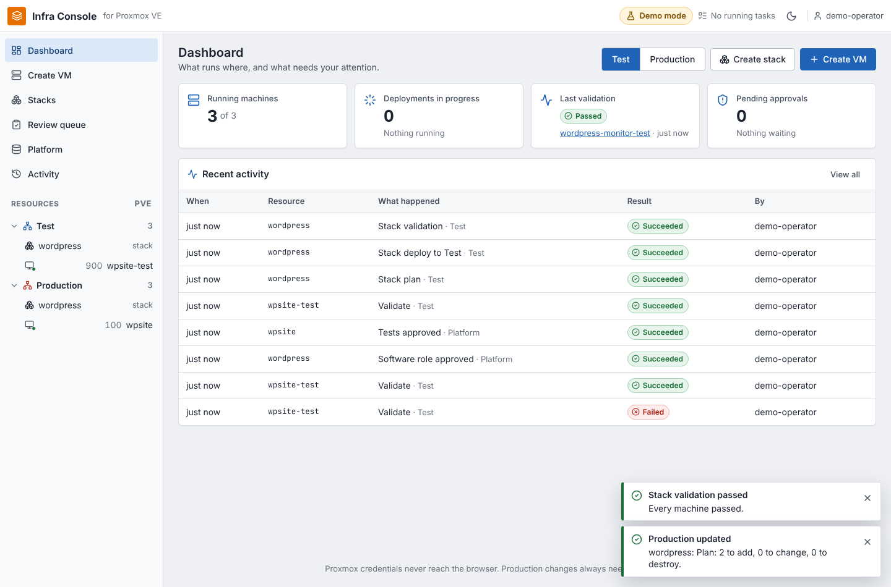

# Proxmox AI Infra Console

AI-assisted Proxmox VM lifecycle: create cloud-init templates, deploy test VMs, validate them, and promote or recreate production VMs through a web console.

A small self-hosted platform that turns **"I need a VM"** into a reviewed, validated, approved change:

```
Bootstrap (once) ─▶ Platform: cloud images + templates ─▶ Plan ─▶ AI review ─▶ TEST deploy + Ansible ─▶ Validate ─▶ Human approval ─▶ PRODUCTION
```

- **Web console** (Vue 3) for office and IT staff: dashboard, guided wizards, review queue, light Proxmox-style theme with optional dark mode ([UI_GUIDELINES.md](UI_GUIDELINES.md))
- **Backend API** (FastAPI) that alone holds the Proxmox API token
- **Creates everything it needs, as code**: a one-time admin bootstrap (user, role, token, pool, storage, SDN vnets) and a platform stack the console runs itself (official cloud images → templates)
- **Infrastructure as Code** with OpenTofu/Terraform and the `bpg/proxmox` provider, separate state per stack and environment
- **Configures the machines** with Ansible after deploy: Linux over SSH, Windows over WinRM, from software profiles discovered per project plus apt/Chocolatey packages
- **Stacks**: several VMs, LXC containers and Docker services deployed, validated and promoted together ([docs/stacks.md](docs/stacks.md))
- **AI assistance** (Claude): drafts machines and whole architectures, works out which software a request needs (required vs. optional, checked against the real package repositories), drafts Ansible roles and test suites for review, explains plans with a risk rating, diagnoses failures. Advisory only: drafts wait in a review queue.
- **Automated tests**: security baseline plus application tests on every validation, inside the machine and from the network ([docs/testing.md](docs/testing.md))
- **TEST** for disposable VMs, **PRODUCTION** behind validation plus explicit human approval
- **Demo mode** (`LIVE_MODE=false`) runs the whole workflow with no Proxmox, VPN, DNS or internet

> **Setting up a real environment?** Follow [OVERVIEW.md](OVERVIEW.md): every step from a bare Proxmox node to the first promoted VM and stack.



---

## Contents

- [Architecture](#architecture)
- [Features](#features)
- [Prerequisites](#prerequisites)
- [Install a release](#install-a-release)
- [Quick start (mock mode, 2 minutes)](#quick-start-mock-mode-2-minutes)
- [Going live against Proxmox](#going-live-against-proxmox)
- [Workflows](#workflows): test deployment, production promotion, recreate
- [Sign-in and roles](#sign-in-and-roles)
- [Backup and upgrade](#backup-and-upgrade)
- [Security model](#security-model)
- [Configuration reference](#configuration-reference)
- [Development](#development)
- [Troubleshooting](#troubleshooting)
- [License](#license)

## Architecture


| Component | Responsibility |
|---|---|
| `frontend/` | Single-page console. Talks only to `/api`. Never sees credentials. |
| `backend/app/routes` | REST API: plans, deploy, validation, promotion, AI. |
| `backend/app/services` | Proxmox API client (+ mock), OpenTofu runner (+ mock), template mapping, validation, AI with guardrails. |
| `backend/app/workers/job_runner.py` | Background jobs with persisted logs; one writer per environment state. |
| `infra/` | VM stack: root module + reusable `modules/vm`, `environments/{test,prod}.tfvars`. |
| `infra/platform/` | Platform stack (run by the console): cloud-image downloads and templates. |
| `infra/bootstrap/` | Admin-only stack (run once from the CLI): identity, ACLs, pool, storage, SDN. Not shipped in the image. |
| `infra/ansible/` | Playbook and roles for Linux and Windows software profiles. |

More detail: [docs/architecture.md](docs/architecture.md).

## Features

| | TEST | PRODUCTION |
|---|---|---|
| VM ID range | 900–999 | 100–299 |
| Default size | 2 vCPU / 4 GB / 32 GB | 2 vCPU / 4 GB / 32 GB |
| UI + API limits | 4 vCPU / 8 GB / 64 GB | 8 vCPU / 16 GB / 128 GB |
| Clone type | linked | full |
| Network | test VLAN (isolated) | production VLAN |
| Deploy | after plan review | only via promotion: passing TEST validation + checkbox + typed `PROMOTE` |
| State | `/workspace/state/test` | `/workspace/state/prod` |

- **Plan panel** with create/update/destroy counts; destructive changes are flagged in red.
- **AI review**: summary, risk (low/medium/high), pre-flight checks, approval recommendation. Any destroy is HIGH and the AI can never lower that.
- **Validation**: VM running, cloud-init finished, QEMU guest agent reports an IP, optional TCP health check, overall PASS/FAIL.
- **Recreate**: destroy and clone again from the template (cloud-init reruns). In production this also requires typed approval (`RECREATE`).
- **Sign-in with your directory**: Authentik, Microsoft Entra ID, AD FS (OIDC) or Active Directory / OpenLDAP (LDAP). Roles viewer, operator, approver come from groups; optional four-eyes rule for production. See [docs/authentication.md](docs/authentication.md).
- **History**: every plan, deploy, validation, approval and sign-in with the signed-in user and plan summary.
- **Install, upgrade, backup**: release archives with `scripts/install.sh`, `scripts/upgrade.sh`, `scripts/backup.sh` / `restore.sh`; images on ghcr.io.
- **Platform**: shows every resource the console depends on (networks, storage, pool, templates) and who creates it; *Check what is missing* plans the platform stack, *Prepare platform* applies it (cloud images, VM templates, LXC templates).
- **Software per project**: profiles are discovered from Ansible role folders (built-in plus a project `profiles/` folder, re-read live), plus free-form apt/Chocolatey packages per VM. Ansible installs them after deploy, recreate and promotion; *Configure* re-runs it; validation checks it. See [docs/configuration.md](docs/configuration.md).
- **Windows Server 2022** alongside Ubuntu 24.04 and Debian 12 (Windows template provided once, see [docs/windows-template.md](docs/windows-template.md)). Template, cloud-init clone, Ansible configuration and Windows tests were run end to end on an emulated Proxmox-style VM; see [what was verified](docs/windows-template.md#verification).

## Prerequisites

- Docker Engine with Compose v2 (for the console)
- For live mode: Proxmox VE 8.x (8.4+ for the API template build; the shell script works on 7.2+), a least-privilege API token, a cloud-init template per OS
- Optional: an Anthropic API key

## Install a release

Each release on GitHub has an install archive and images on `ghcr.io`. On the console host (Docker with Compose v2):

```bash
sha256sum -c proxmox-ai-infra-<version>.tar.gz.sha256
tar xzf proxmox-ai-infra-<version>.tar.gz && cd proxmox-ai-infra-<version>
scripts/install.sh            # asks for Proxmox and sign-in, writes .env and secrets/, pulls, starts
```

The full path from a bare Proxmox node to the first production VM is in [OVERVIEW.md](OVERVIEW.md). For a private
repository, `docker login ghcr.io` with a token that has `read:packages` first (or `scripts/install.sh --build`).

## Quick start (mock mode, 2 minutes)

```bash
git clone git@github.com:LetsManu/proxmox-ai-infra-demo.git
cd proxmox-ai-infra-demo
cp .env.example .env          # LIVE_MODE=false by default
docker compose up -d --build
open http://localhost:8080    # or xdg-open / just browse to it
```

No `.env` at all also works: the backend falls back to safe defaults (mock mode).

Then click through: **Platform → Check what is missing → Prepare platform**, then **Create VM → Draft with assistant → Continue → Continue → Create plan → Deploy to Test → Validate → Request production approval → tick the checkbox, type `PROMOTE` → Approve and deploy**. The full presenter script is in [DEMO.md](DEMO.md).

## Going live against Proxmox

1. **Bootstrap once (admin, from your workstation)**. Creates the least-privilege user, role, API token and ACLs, a resource pool, an image/snippet storage and the `vtest`/`vprod` VLAN vnets, and writes the token secret to `secrets/`:
   ```bash
   export PROXMOX_VE_ENDPOINT=https://<proxmox-host>:8006/ PROXMOX_VE_USERNAME=root@pam
   read -rs PROXMOX_VE_PASSWORD && export PROXMOX_VE_PASSWORD
   infra/scripts/bootstrap.sh -var node_name=pve      # shows the plan, asks you to type BOOTSTRAP
   ```
   Then put the printed values into `.env`. Details: [docs/proxmox-setup.md](docs/proxmox-setup.md), [docs/api-token-setup.md](docs/api-token-setup.md).
2. **Secrets for configuration**: `secrets/ansible_ssh_key` (private key whose public half is `DEFAULT_SSH_PUBLIC_KEY`) and, for Windows, `secrets/windows_admin_password`. See [docs/configuration.md](docs/configuration.md).
3. **Start** with the secrets override: `docker compose -f docker-compose.yml -f docker-compose.secrets.yml up -d --build`. The header shows **Connected to Proxmox**.
4. **Platform → Check what is missing** in the console plans the platform stack (official Ubuntu/Debian cloud images → templates, LXC templates); **Prepare platform** applies it. Needs PVE 8.4+ (content type `import`). On older versions use `infra/scripts/create-cloudinit-template.sh` ([docs/cloud-images.md](docs/cloud-images.md)).
5. Optional: provide the Windows template once ([docs/windows-template.md](docs/windows-template.md)).

### Proxmox API token (manual alternative to the bootstrap)

```bash
pveum user add automation@pve --comment "proxmox-ai-infra-demo"
pveum role add InfraDemo -privs "VM.Allocate VM.Clone VM.Audit VM.PowerMgmt VM.Config.CDROM VM.Config.CPU VM.Config.Cloudinit VM.Config.Disk VM.Config.HWType VM.Config.Memory VM.Config.Network VM.Config.Options VM.Monitor Datastore.AllocateSpace Datastore.Audit SDN.Use Sys.Audit"
pveum user token add automation@pve infra-demo --privsep 1   # prints the secret ONCE
for who in "-user automation@pve" '-token automation@pve!infra-demo'; do
  pveum acl modify /vms                 $who -role InfraDemo
  pveum acl modify /storage/local-lvm   $who -role InfraDemo
  pveum acl modify /sdn/zones/localnetwork $who -role InfraDemo
  pveum acl modify /nodes/pve           $who -role InfraDemo
done
```

On Proxmox VE 9, replace `VM.Monitor` with `VM.GuestAgent.Audit VM.GuestAgent.FileRead`. The backend sends `Authorization: PVEAPIToken=automation@pve!infra-demo=<secret>`.

## Workflows

### Platform (once, and after template updates)

The **Platform** page lists every resource the console depends on and who creates it. Missing templates block new machines. **Check what is missing** plans the platform stack; **Prepare platform** applies the reviewed plan.

### Test deployment

1. **Create VM**: describe the need; the assistant drafts size, OS and the software (required and optional, each matched to a profile, a repository package or a role draft). Review the **Basics** and **Software** steps.
2. **Create plan**: the backend checks the template exists, allocates a free VM ID in 900–999, renders `var.vms` from its database and runs `tofu plan -out`. The plan is shown as a sentence, a list of changes and a risk rating (**Why?** for details, **View full plan** for the raw output).
3. **Deploy to Test** applies **exactly that saved plan**, then Ansible installs the base configuration and the software. Changing anything invalidates the plan (server-side check). **Install software again** re-runs Ansible.
4. **Validate**: platform checks, security baseline and application tests. **Draft tests with assistant** proposes an application suite for the review queue.

### Stacks

**Stacks → Create stack**: the assistant proposes VMs, containers and Docker services, you edit them, then one plan, one deploy, one validation and one production approval for all members. See [docs/stacks.md](docs/stacks.md).

### Production promotion

1. Requires a **PASS** validation of the TEST VM that is newer than its last deployment.
2. **Request production approval**: the TEST spec is copied to PRODUCTION (`-test` suffix dropped, prod network, full clone, VM ID 100–299) and planned. The job parks in `awaiting_approval`. **Nothing changes.**
3. The approver sees exactly what will happen in a dialog, ticks *"I understand this will affect the production environment."* and types `PROMOTE`. Requests can also be approved or rejected later from the **Review queue**.
4. The backend re-checks every condition (job state, age < 60 min, acknowledgement, exact word, TEST validation) and applies the saved plan. Each decision is recorded in history.

The same flow is available on the command line: `infra/scripts/promote.sh` refuses to run without an interactive terminal and asks for `PROMOTE`.

### Recreate

- **TEST**: one click. `tofu plan -replace=…` then apply. Validation state is reset.
- **PRODUCTION**: plan with `-replace`, then the approval panel with the word `RECREATE`. The plan is marked destructive and HIGH risk. If the VM holds data, restore from backup instead (the AI troubleshooting output says so).

## Sign-in and roles

| `AUTH_MODE` | Directory |
|---|---|
| `oidc` | Authentik, Microsoft Entra ID, AD FS, Keycloak (single sign-on, PKCE) |
| `ldap` | Active Directory (incl. nested groups and UPN sign-in), OpenLDAP, Authentik LDAP outpost (LDAPS or StartTLS) |
| `none` | no sign-in; demo on your own machine only |

| Role | May |
|---|---|
| viewer | see everything |
| operator | plan, deploy, validate and configure in Test; request production changes |
| approver | approve production changes, apply the platform stack, approve AI drafts |

Groups map to roles with `AUTH_VIEWER_GROUPS`, `AUTH_OPERATOR_GROUPS`, `AUTH_APPROVER_GROUPS`; `AUTH_FOUR_EYES=true`
keeps people from approving their own production request. Step-by-step setup for each directory:
[docs/authentication.md](docs/authentication.md).

## Backup and upgrade

```bash
scripts/backup.sh                                  # database, OpenTofu state, approved roles, SSH host keys -> backups/
scripts/restore.sh backups/console-<time>.tar.gz   # type RESTORE; Proxmox itself is not touched
scripts/upgrade.sh                                 # after extracting a new release here: backup, pull, restart
```

Secrets are not in the backup: keep `secrets/` and `.env` in your vault. Run `backup.sh` daily from cron and copy
`backups/` off the host.

## Security model

- **Credentials stay server-side.** The Proxmox token lives in `.env` or a Docker secret (`docker-compose.secrets.yml`, `*_FILE` variables), is passed to OpenTofu as environment variables, is scrubbed from job logs, and is never returned by any endpoint.
- **Least privilege.** Dedicated `automation@pve` user with a custom role, privilege-separated token, ACLs limited to `/vms`, the storage pool, the bridge zone and the node. Never root.
- **Separate state** for TEST and PRODUCTION, one writer per state (job lock).
- **Production needs a human.** Validation gate, plan review, checkbox, typed word, 60-minute plan expiry, double-approval protection. All enforced in the API, not only in the browser.
- **Admin rights stay outside the console.** Identity, ACLs, storage and networks are created by the bootstrap stack from an admin's shell; the console image does not even contain it. The console's token can build templates and VMs in its pool, nothing more.
- **Configuration from a catalog.** Software is installed only through reviewed Ansible roles and package managers; there is no free-form command execution, for users or the AI. AI-drafted roles and tests are used only after automated checks and a person's approval. SSH keys and the Windows password come from Docker secrets and are masked in logs.
- **AI is advisory.** It has no route to deploy or approve. Its output is validated: unknown templates, oversized VMs and free-form commands are rejected; specs are forced to TEST; risk can only go up; "approved" wording is stripped.
- **Nothing reaches Ansible as code.** Everything the console passes to a playbook (profiles, packages, compose files, test checks) is tagged `!unsafe`, so Ansible never evaluates templates in it; guest-reported IPs are validated; Ansible gets a minimal environment without the console's secrets. AI-drafted roles are rejected if they contain lookups, controller-side file sources, delegation or non-allowlisted modules.
- **Containers are hardened**: non-root, read-only root filesystem, all capabilities dropped, `no-new-privileges`, rotated logs. The backend port binds to `127.0.0.1` only.
- **Repository hygiene**: `.gitignore` covers `.env`, state, plans, secrets, logs; pre-commit hook (`git config core.hooksPath .githooks`) and CI run gitleaks.
- **Sign-in and roles** from your directory (OIDC or LDAP over TLS). Server-side sessions (only a hash of the token is stored), `HttpOnly`/`SameSite` cookie, a CSRF check on every change, PKCE plus nonce and audience checks for OIDC, escaped filters and a lockout for LDAP. Every write needs the operator role, every production decision the approver role, optionally from a second person. Details: [docs/authentication.md](docs/authentication.md#security-notes).
- **HTTPS**: terminate it in a reverse proxy in front of the console; `FRONTEND_BIND=127.0.0.1` by default so nothing else reaches it.
- **Browser hardening**: strict Content-Security-Policy (no inline or third-party scripts, no framing), `X-Content-Type-Options`, `Referrer-Policy`, `Permissions-Policy`.

See [SECURITY.md](SECURITY.md) for reporting issues.

## Configuration reference

All settings are environment variables; see [.env.example](.env.example) for the full annotated list.

| Variable | Default | Purpose |
|---|---|---|
| `LIVE_MODE` | `false` | `true` = real Proxmox + OpenTofu, `false` = mock |
| `PROXMOX_HOST` / `PROXMOX_PORT` | – / `8006` | API endpoint |
| `PROXMOX_USER` / `PROXMOX_TOKEN_ID` / `PROXMOX_TOKEN_SECRET` | `automation@pve` / `infra-demo` / – | API token (`USER@REALM!TOKENID=SECRET`) |
| `PROXMOX_VERIFY_SSL` | `true` | `false` only for a self-signed lab cert |
| `PROXMOX_NODE` | `pve` | Target node |
| `TEST_STORAGE`, `TEST_BRIDGE`, `TEST_VLAN` | `local-lvm`, `vmbr0`, `30` | TEST placement |
| `PROD_STORAGE`, `PROD_BRIDGE`, `PROD_VLAN` | `local-lvm`, `vmbr0`, `10` | PROD placement |
| `TEMPLATE_UBUNTU_2404_ID`, `TEMPLATE_DEBIAN_12_ID` | `9000`, `9001` | UI template → Proxmox template |
| `UBUNTU_2404_IMAGE_URL`, `DEBIAN_12_IMAGE_URL` | official URLs | Cloud images for template builds |
| `IAC_BINARY` | `tofu` | `tofu` or `terraform` |
| `TEMPLATE_WINDOWS_2022_ID` | `9002` | Windows template (provided once) |
| `DEBIAN_12_CT_URL`, `UBUNTU_2404_CT_URL`, `CT_STORAGE` | official URLs, `IMAGE_STORAGE` | LXC templates for stack containers |
| `PACKAGE_CHECK` | `live` | `live` / `offline` / `off`: package lookups against the repositories |
| `APPROVED_PROFILES_DIR` | `WORKSPACE_DIR/profiles` | Where approved AI-drafted roles are stored |
| `POOL_ID`, `IMAGE_STORAGE`, `SNIPPETS_DATASTORE` | –, `local`, – | From the bootstrap output |
| `ANSIBLE_SSH_KEY_FILE`, `WINDOWS_ADMIN_PASSWORD` | – | Software configuration (prefer Docker secrets) |
| `PROFILES_DIR`, `EXTRA_PROFILE_DIRS`, `PACKAGE_DENYLIST` | `./profiles`, `/profiles`, – | Project software profiles and package policy |
| `AI_PROVIDER`, `ANTHROPIC_API_KEY`, `AI_MODEL`, `AI_MAX_TOKENS` | `none`, –, `claude-opus-5-5`, `4000` | AI assistance |
| `AUTH_MODE` | `none` | `oidc`, `ldap` or `none` ([docs/authentication.md](docs/authentication.md)) |
| `AUTH_VIEWER_GROUPS`, `AUTH_OPERATOR_GROUPS`, `AUTH_APPROVER_GROUPS`, `AUTH_FOUR_EYES` | –, –, –, `false` | Groups per role (`;`-separated), four-eyes rule |
| `PUBLIC_URL`, `AUTH_COOKIE_SECURE`, `AUTH_SESSION_HOURS` | `http://localhost:8080`, `true`, `8` | Browser address (OIDC redirect), cookie over HTTPS only, session length |
| `OIDC_ISSUER`, `OIDC_CLIENT_ID`, `OIDC_CLIENT_SECRET`, `OIDC_GROUPS_CLAIM` | –, –, –, `groups` | OIDC provider (secret via `secrets/oidc_client_secret`) |
| `LDAP_URL`, `LDAP_BIND_DN`, `LDAP_BIND_PASSWORD`, `LDAP_BASE_DN`, `LDAP_USER_FILTER`, `LDAP_NESTED_GROUPS`, `LDAP_CA_FILE` | AD defaults | Directory (password via `secrets/ldap_bind_password`, CA in `certs/`) |
| `VERSION`, `IMAGE_REGISTRY` | `dev`, `ghcr.io/letsmanu/proxmox-ai-infra-demo` | Release images (set by `scripts/install.sh`) |
| `FRONTEND_PORT`, `BACKEND_PORT` | `8080`, `8000` | Published ports |

### API

| Method | Path | |
|---|---|---|
| GET | `/api/health`, `/api/proxmox/status`, `/api/templates`, `/api/environments`, `/api/vms`, `/api/history`, `/api/jobs/{id}` | Read |
| POST | `/api/vms/plan` | Plan (job) |
| POST | `/api/vms/deploy/test` | Apply a reviewed TEST plan (job) |
| POST | `/api/vms/validate` | Validate a VM (job) |
| POST | `/api/vms/promote/production` | `stage: request / approve / reject` |
| POST | `/api/vms/recreate` | TEST direct, PROD with approval |
| POST | `/api/vms/configure` | Re-run Ansible for a TEST VM (job) |
| POST | `/api/vms/power` | Start/stop (TEST only) |
| GET | `/api/platform`, `/api/profiles` | Platform resource status; discovered software profiles (re-read per call) |
| POST | `/api/platform/plan`, `/api/platform/apply` | Plan / apply the platform stack (jobs) |
| GET | `/api/jobs?status=&vm_name=&action=` | Recent jobs (no logs) |
| GET / POST | `/api/vms/tests`, `/api/vms/tests/draft` | Test suite of a machine; draft an application suite (proposal) |
| GET / POST | `/api/stacks`, `/api/stacks/plan`, `/api/stacks/deploy`, `/api/stacks/validate`, `/api/stacks/promote` | Stacks |
| GET / POST | `/api/proposals`, `/api/proposals/{id}/approve`, `/api/proposals/{id}/reject` | Review queue for AI drafts |
| POST | `/api/ai/generate-vm-spec`, `/api/ai/generate-stack`, `/api/ai/summarize-plan`, `/api/ai/troubleshoot` | AI (advisory) |

Interactive docs: `http://localhost:8000/docs` (backend port, localhost only).

## Development

```bash
# Backend
cd backend && python -m venv .venv && . .venv/bin/activate
pip install -r requirements.txt -r requirements-dev.txt
pytest -q                                   # full mock workflow + AI guardrail tests
WORKSPACE_DIR=/tmp/ws DATABASE_URL=sqlite:////tmp/app.db INFRA_DIR=../infra uvicorn app.main:app --reload

# Frontend (proxies /api to :8000)
cd frontend && npm install && npm run dev   # http://localhost:5173

# IaC
cd infra && tofu fmt -check -recursive && tofu init -backend=false && tofu validate
```

Enable the secret-scanning pre-commit hook once: `git config core.hooksPath .githooks` (needs [gitleaks](https://github.com/gitleaks/gitleaks)).

## Troubleshooting

| Symptom | Likely cause | Fix |
|---|---|---|
| Platform page says *Proxmox is not reachable* | Host/VPN/DNS, wrong port, TLS | `curl -k https://<host>:8006/api2/json/version`; for the demo set `LIVE_MODE=false` |
| `401` in job log | Wrong user/realm, token ID or secret | `PROXMOX_USER=automation@pve`, `PROXMOX_TOKEN_ID=infra-demo` (name only) |
| `403 Permission denied` | Missing ACL, or privsep token without its own ACL | `pveum user permissions automation@pve`; add the ACL for the token too |
| OS shows "not available yet" | Platform not prepared | **Platform → Check what is missing → Prepare platform** |
| Platform plan fails on `import` | PVE older than 8.4 or storage without content `import` | Use the bootstrap storage, or build templates with the script |
| "Software installed: skipped" | No `ANSIBLE_SSH_KEY_FILE` / `WINDOWS_ADMIN_PASSWORD` | Add the Docker secrets, then **Install software again** on the machine page |
| Ansible `UNREACHABLE` | VM not reachable from the console host (firewall/VLAN routing), WinRM listener missing | Check routing from the Docker host to the VM VLANs; see docs/windows-template.md |
| Validation: no IP | `qemu-guest-agent` missing in the image, or no DHCP on the VLAN | Rebuild the template with `--install-agent`; check DHCP |
| Validation: cloud-init not completed | No DNS/internet on the test VLAN, broken snippet | `cloud-init status --long` on the VM console |
| Windows: *WinRM HTTPS 5986 is not open* | cloudbase-init has not finished, or `metadata_services` is not `ConfigDriveService` | cloudbase-init log on COM1 / `C:\Program Files\Cloudbase Solutions\Cloudbase-Init\log`; see docs/windows-template.md |
| Windows baseline: *Unencrypted WinRM (5985)* fails | Template still has the HTTP listener | Add the `LocalScripts` line from docs/windows-template.md step 4 and rebuild the template |
| Sign-in: *none of the console's groups* | Group names differ from what the directory sends | [docs/authentication.md#troubleshooting](docs/authentication.md#troubleshooting) |
| Signed in, but back on the sign-in page | `AUTH_COOKIE_SECURE=true` over plain HTTP | Use HTTPS, or `false` in a lab |
| `Saved plan is stale` | State changed between plan and apply | Create a new plan |
| `VM ID … outside the allowed range` | Wrong environment/tfvars | Check `environments/*.tfvars` |
| Assistant shows *Local rules* | No key, `AI_PROVIDER=none`, or provider unreachable | Expected offline; set `AI_PROVIDER=anthropic` + key |

Logs: `docker compose logs -f backend`. Reset demo data: `docker compose down -v`.

## Screenshots

See [docs/screenshots.md](docs/screenshots.md).

## License

Suggested: **MIT** for a demo/teaching repository (maximum reuse), or **AGPL-3.0-or-later** if you want hosted modifications to stay open (as in friendflix). No license file is included yet; add one before making the repository public.
