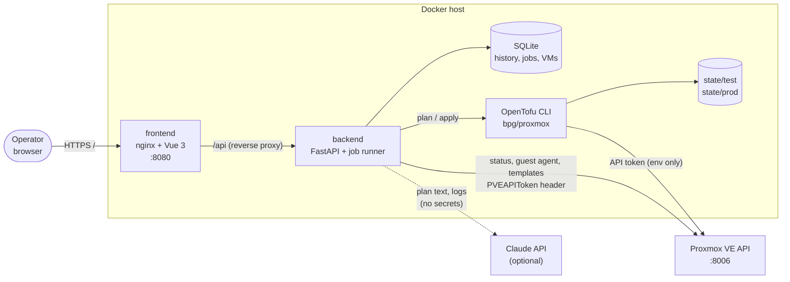

# Proxmox AI Infra Console

AI-assisted Proxmox VM lifecycle: create cloud-init templates, deploy test VMs, validate them, and promote or recreate production VMs through a web console.

A small self-hosted platform that turns **"I need a VM"** into a reviewed, validated, approved change:

```
Cloud image ─▶ cloud-init template ─▶ Plan (OpenTofu) ─▶ AI review ─▶ TEST deploy ─▶ Validate ─▶ Human approval ─▶ PRODUCTION
```

- **Web console** (Vue 3) to describe, plan, deploy, validate, promote and recreate VMs
- **Backend API** (FastAPI) that alone holds the Proxmox API token
- **Infrastructure as Code** with OpenTofu/Terraform and the `bpg/proxmox` provider, separate state per environment
- **AI assistance** (Claude): natural-language VM specs, plain-English plan reviews with a risk rating, troubleshooting. Advisory only.
- **TEST** for disposable VMs, **PRODUCTION** behind validation plus explicit human approval
- **Mock mode** runs the whole workflow with no Proxmox, VPN, DNS or internet


---

## Contents

- [Architecture](#architecture)
- [Features](#features)
- [Prerequisites](#prerequisites)
- [Quick start (mock mode, 2 minutes)](#quick-start-mock-mode-2-minutes)
- [Going live against Proxmox](#going-live-against-proxmox)
- [Workflows](#workflows): test deployment, production promotion, recreate
- [Security model](#security-model)
- [Configuration reference](#configuration-reference)
- [Development](#development)
- [Troubleshooting](#troubleshooting)
- [License](#license)

## Architecture



| Component | Responsibility |
|---|---|
| `frontend/` | Single-page console. Talks only to `/api`. Never sees credentials. |
| `backend/app/routes` | REST API: plans, deploy, validation, promotion, AI. |
| `backend/app/services` | Proxmox API client (+ mock), OpenTofu runner (+ mock), template mapping, validation, AI with guardrails. |
| `backend/app/workers/job_runner.py` | Background jobs with persisted logs; one writer per environment state. |
| `infra/` | Root module + reusable `modules/vm`, `environments/{test,prod}.tfvars`, scripts. |

More detail: [docs/architecture.md](docs/architecture.md).

## Features

| | TEST | PRODUCTION |
|---|---|---|
| VM ID range | 900–999 | 100–299 |
| Default size | 2 vCPU / 4 GB / 32 GB | 2 vCPU / 4 GB / 32 GB |
| UI + API limits | 4 vCPU / 8 GB / 64 GB | 8 vCPU / 16 GB / 128 GB |
| Clone type | linked | full |
| Network | test VLAN (isolated) | production VLAN |
| Deploy | after plan review | only via promotion: passing TEST validation + checkbox + typed `PROMOTE` |
| State | `/workspace/state/test` | `/workspace/state/prod` |

- **Plan panel** with create/update/destroy counts; destructive changes are flagged in red.
- **AI review**: summary, risk (low/medium/high), pre-flight checks, approval recommendation. Any destroy is HIGH and the AI can never lower that.
- **Validation**: VM running, cloud-init finished, QEMU guest agent reports an IP, optional TCP health check, overall PASS/FAIL.
- **Recreate**: destroy and clone again from the template (cloud-init reruns). In production this also requires typed approval (`RECREATE`).
- **History**: every plan, deploy, validation and approval with user and plan summary.
- **Templates**: build Ubuntu 24.04 / Debian 12 cloud-init templates from the official cloud images.

## Prerequisites

- Docker Engine with Compose v2 (for the console)
- For live mode: Proxmox VE 8.x (8.4+ for the API template build; the shell script works on 7.2+), a least-privilege API token, a cloud-init template per OS
- Optional: an Anthropic API key

## Quick start (mock mode, 2 minutes)

```bash
git clone git@github.com:LetsManu/proxmox-ai-infra-demo.git
cd proxmox-ai-infra-demo
cp .env.example .env          # LIVE_MODE=false by default
docker compose up -d --build
open http://localhost:8080    # or xdg-open / just browse to it
```

No `.env` at all also works: the backend falls back to safe defaults (mock mode).

Then click through: **Draft spec → Use this spec → Generate Plan → Deploy to Test → Validate → Request Production Promotion → tick the checkbox, type `PROMOTE` → Approve**. The full presenter script is in [DEMO.md](DEMO.md).

## Going live against Proxmox

1. **Create the automation user and token**: [docs/api-token-setup.md](docs/api-token-setup.md) (short version below).
2. **Prepare storage, bridges/VLANs and SSH keys**: [docs/proxmox-setup.md](docs/proxmox-setup.md).
3. **Build templates** on the Proxmox node: [docs/cloud-images.md](docs/cloud-images.md).
   ```bash
   scp infra/scripts/create-cloudinit-template.sh .env root@<proxmox-node>:/root/
   ssh root@<proxmox-node> './create-cloudinit-template.sh --os ubuntu-24-04 --vmid 9000 --env-file ./.env --ssh-key ~/.ssh/id_ed25519.pub --install-agent'
   ssh root@<proxmox-node> './create-cloudinit-template.sh --os debian-12   --vmid 9001 --env-file ./.env --ssh-key ~/.ssh/id_ed25519.pub --install-agent'
   ```
   (Copy `.env` only if it holds no secrets yet, or pass `--image-url` instead.)
4. **Configure `.env`**: `LIVE_MODE=true`, `PROXMOX_*`, storage/bridge/VLAN, template IDs, `DEFAULT_SSH_PUBLIC_KEY`.
5. `docker compose up -d --build`. The header should show **Live** and `PVE 8.x · <node>`.

### Proxmox API token (short version)

```bash
pveum user add automation@pve --comment "proxmox-ai-infra-demo"
pveum role add InfraDemo -privs "VM.Allocate VM.Clone VM.Audit VM.PowerMgmt VM.Config.CDROM VM.Config.CPU VM.Config.Cloudinit VM.Config.Disk VM.Config.HWType VM.Config.Memory VM.Config.Network VM.Config.Options VM.Monitor Datastore.AllocateSpace Datastore.Audit SDN.Use Sys.Audit"
pveum user token add automation@pve infra-demo --privsep 1   # prints the secret ONCE
for who in "-user automation@pve" '-token automation@pve!infra-demo'; do
  pveum acl modify /vms                 $who -role InfraDemo
  pveum acl modify /storage/local-lvm   $who -role InfraDemo
  pveum acl modify /sdn/zones/localnetwork $who -role InfraDemo
  pveum acl modify /nodes/pve           $who -role InfraDemo
done
```

On Proxmox VE 9, replace `VM.Monitor` with `VM.GuestAgent.Audit VM.GuestAgent.FileRead`. The backend sends `Authorization: PVEAPIToken=automation@pve!infra-demo=<secret>`.

## Workflows

### Test deployment

1. Pick **Test**, fill the form (or let the AI draft it).
2. **Generate Plan**: the backend checks the template exists, allocates a free VM ID in 900–999, renders `var.vms` from its database and runs `tofu plan -out`. The AI reviews the plan.
3. **Deploy to Test** applies **exactly that saved plan**. Changing the form invalidates it (server-side check).
4. **Validate**: running, cloud-init done, guest-agent IP, optional port check.

### Production promotion

1. Requires a **PASS** validation of the TEST VM that is newer than its last deployment.
2. **Request Production Promotion**: the TEST spec is copied to PRODUCTION (`-test` suffix dropped, prod network, full clone, VM ID 100–299) and planned. The job parks in `awaiting_approval`. **Nothing changes.**
3. The approver reads the plan and the AI risk review, ticks *"I understand this will change production"* and types `PROMOTE`.
4. The backend re-checks every condition (job state, age < 60 min, acknowledgement, exact word, TEST validation) and applies the saved plan. Each decision is recorded in history.

The same flow is available on the command line: `infra/scripts/promote.sh` refuses to run without an interactive terminal and asks for `PROMOTE`.

### Recreate

- **TEST**: one click. `tofu plan -replace=…` then apply. Validation state is reset.
- **PRODUCTION**: plan with `-replace`, then the approval panel with the word `RECREATE`. The plan is marked destructive and HIGH risk. If the VM holds data, restore from backup instead (the AI troubleshooting output says so).

## Security model

- **Credentials stay server-side.** The Proxmox token lives in `.env` or a Docker secret (`docker-compose.secrets.yml`, `*_FILE` variables), is passed to OpenTofu as environment variables, is scrubbed from job logs, and is never returned by any endpoint.
- **Least privilege.** Dedicated `automation@pve` user with a custom role, privilege-separated token, ACLs limited to `/vms`, the storage pool, the bridge zone and the node. Never root.
- **Separate state** for TEST and PRODUCTION, one writer per state (job lock).
- **Production needs a human.** Validation gate, plan review, checkbox, typed word, 60-minute plan expiry, double-approval protection. All enforced in the API, not only in the browser.
- **AI is advisory.** It has no route to deploy or approve. Its output is validated: unknown templates, oversized VMs, dangerous cloud-init commands are rejected; specs are forced to TEST; risk can only go up; "approved" wording is stripped.
- **Containers are hardened**: non-root, read-only root filesystem, all capabilities dropped, `no-new-privileges`, rotated logs. The backend port binds to `127.0.0.1` only.
- **Repository hygiene**: `.gitignore` covers `.env`, state, plans, secrets, logs; pre-commit hook (`git config core.hooksPath .githooks`) and CI run gitleaks.
- **Not included**: authentication. `APP_USER` is a label for the audit trail. Put the console behind your SSO/reverse proxy (e.g. Authentik, oauth2-proxy) before giving anyone else access.

See [SECURITY.md](SECURITY.md) for reporting issues.

## Configuration reference

All settings are environment variables; see [.env.example](.env.example) for the full annotated list.

| Variable | Default | Purpose |
|---|---|---|
| `LIVE_MODE` | `false` | `true` = real Proxmox + OpenTofu, `false` = mock |
| `PROXMOX_HOST` / `PROXMOX_PORT` | – / `8006` | API endpoint |
| `PROXMOX_USER` / `PROXMOX_TOKEN_ID` / `PROXMOX_TOKEN_SECRET` | `automation@pve` / `infra-demo` / – | API token (`USER@REALM!TOKENID=SECRET`) |
| `PROXMOX_VERIFY_SSL` | `true` | `false` only for a self-signed lab cert |
| `PROXMOX_NODE` | `pve` | Target node |
| `TEST_STORAGE`, `TEST_BRIDGE`, `TEST_VLAN` | `local-lvm`, `vmbr0`, `30` | TEST placement |
| `PROD_STORAGE`, `PROD_BRIDGE`, `PROD_VLAN` | `local-lvm`, `vmbr0`, `10` | PROD placement |
| `TEMPLATE_UBUNTU_2404_ID`, `TEMPLATE_DEBIAN_12_ID` | `9000`, `9001` | UI template → Proxmox template |
| `UBUNTU_2404_IMAGE_URL`, `DEBIAN_12_IMAGE_URL` | official URLs | Cloud images for template builds |
| `IAC_BINARY` | `tofu` | `tofu` or `terraform` |
| `AI_PROVIDER`, `ANTHROPIC_API_KEY`, `AI_MODEL`, `AI_MAX_TOKENS` | `none`, –, `claude-opus-5-5`, `4000` | AI assistance |
| `FRONTEND_PORT`, `BACKEND_PORT` | `8080`, `8000` | Published ports |

### API

| Method | Path | |
|---|---|---|
| GET | `/api/health`, `/api/proxmox/status`, `/api/templates`, `/api/environments`, `/api/vms`, `/api/history`, `/api/jobs/{id}` | Read |
| POST | `/api/vms/plan` | Plan (job) |
| POST | `/api/vms/deploy/test` | Apply a reviewed TEST plan (job) |
| POST | `/api/vms/validate` | Validate a VM (job) |
| POST | `/api/vms/promote/production` | `stage: request / approve / reject` |
| POST | `/api/vms/recreate` | TEST direct, PROD with approval |
| POST | `/api/vms/power` | Start/stop (TEST only) |
| POST | `/api/templates/build?template=ubuntu-24-04` | Build a template via API (PVE 8.4+) |
| POST | `/api/ai/generate-vm-spec`, `/api/ai/summarize-plan`, `/api/ai/troubleshoot` | AI (advisory) |

Interactive docs: `http://localhost:8000/docs` (backend port, localhost only).

## Development

```bash
# Backend
cd backend && python -m venv .venv && . .venv/bin/activate
pip install -r requirements.txt -r requirements-dev.txt
pytest -q                                   # full mock workflow + AI guardrail tests
WORKSPACE_DIR=/tmp/ws DATABASE_URL=sqlite:////tmp/app.db INFRA_DIR=../infra uvicorn app.main:app --reload

# Frontend (proxies /api to :8000)
cd frontend && npm install && npm run dev   # http://localhost:5173

# IaC
cd infra && tofu fmt -check -recursive && tofu init -backend=false && tofu validate
```

Enable the secret-scanning pre-commit hook once: `git config core.hooksPath .githooks` (needs [gitleaks](https://github.com/gitleaks/gitleaks)).

## Troubleshooting

| Symptom | Likely cause | Fix |
|---|---|---|
| Header shows `Proxmox unreachable` | Host/VPN/DNS, wrong port, TLS | `curl -k https://<host>:8006/api2/json/version`; for the demo set `LIVE_MODE=false` |
| `401` in job log | Wrong user/realm, token ID or secret | `PROXMOX_USER=automation@pve`, `PROXMOX_TOKEN_ID=infra-demo` (name only) |
| `403 Permission denied` | Missing ACL, or privsep token without its own ACL | `pveum user permissions automation@pve`; add the ACL for the token too |
| Template "missing!" in the dropdown | Template ID in `.env` doesn't exist | Build it or fix `TEMPLATE_*_ID` |
| Validation: no IP | `qemu-guest-agent` missing in the image, or no DHCP on the VLAN | Rebuild the template with `--install-agent`; check DHCP |
| Validation: cloud-init not completed | No DNS/internet on the test VLAN, broken snippet | `cloud-init status --long` on the VM console |
| `Saved plan is stale` | State changed between plan and apply | Generate a new plan |
| `VM ID … outside the allowed range` | Wrong environment/tfvars | Check `environments/*.tfvars` |
| Assistant shows *Local rules* | No key, `AI_PROVIDER=none`, or provider unreachable | Expected offline; set `AI_PROVIDER=anthropic` + key |

Logs: `docker compose logs -f backend`. Reset demo data: `docker compose down -v`.

## Screenshots

See [docs/screenshots.md](docs/screenshots.md).

## License

Suggested: **MIT** for a demo/teaching repository (maximum reuse), or **AGPL-3.0-or-later** if you want hosted modifications to stay open (as in friendflix). No license file is included yet; add one before making the repository public.
