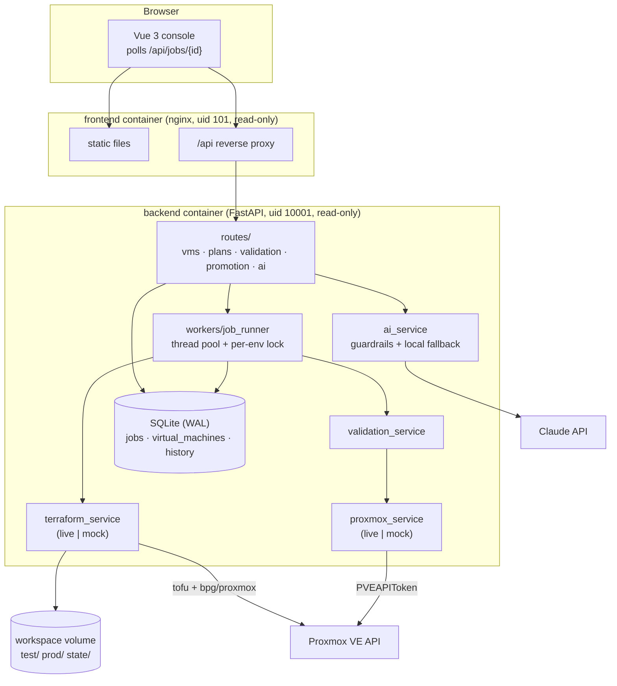
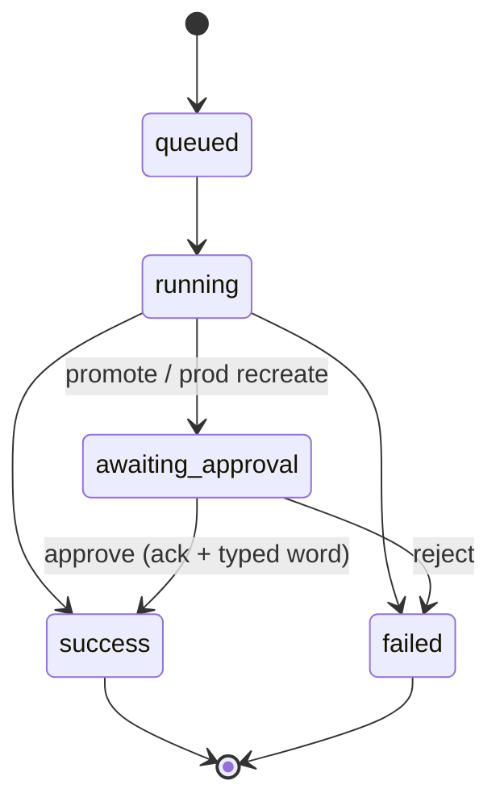
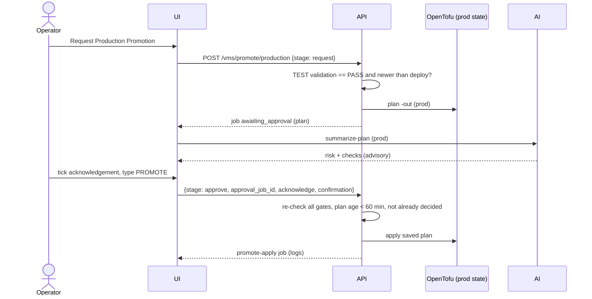

# Architecture

## Components

## Data model

| Table | Purpose |
|---|---|
| `jobs` | Every long-running action: status (`queued`, `running`, `success`, `failed`, `awaiting_approval`), params, logs, result, error, timestamps |
| `virtual_machines` | Desired state per (name, environment): spec, VM ID, IP, last validation. Rendered into OpenTofu `var.vms`. |
| `history` | Audit trail: timestamp, VM, environment, action, status, user, plan summary |

SQLite is enough for one backend replica (WAL mode + busy timeout). SQLAlchemy keeps the code portable: switching to PostgreSQL is a `DATABASE_URL` change.

## Desired state and OpenTofu

- The database is the source of the desired VM list. For each plan the backend writes `/workspace/<env>/generated.tfvars.json` (placement from `.env` + `vms` map) and runs the root module with `-var-file=environments/<env>.tfvars -var-file=generated.tfvars.json`.
- `for_each` over `var.vms` creates one `modules/vm` instance per VM, keyed by name, so adding a VM never touches the others and recreate is `-replace='module.vm["name"].proxmox_virtual_environment_vm.this'`.
- **Separate state**: `tofu init -backend-config=path=/workspace/state/<env>/terraform.tfstate` and a separate `TF_DATA_DIR` per environment. A per-environment lock in the job runner ensures one writer per state.
- **Plan/apply integrity**: plans are saved with `-out`; deploy/approve apply that exact file. If the infrastructure changed in between, OpenTofu refuses (`Saved plan is stale`).
- **Policy in two places**: the API rejects specs over the environment limits; the OpenTofu config repeats the guardrails (`check "resource_limits"`, VM ID range `precondition`), so a manual `tofu apply` with bad input fails too.
- The provider is pre-downloaded into the backend image (`TF_PLUGIN_CACHE_DIR`), and `.terraform.lock.hcl` is committed.

## Job lifecycle

Approval creates a separate `promote-apply` / `recreate-apply` job that applies the parked plan. On backend restart, jobs left in `queued`/`running` are marked failed.

## Promotion sequence

## Mock mode

`LIVE_MODE=false` swaps `ProxmoxClient` for `MockProxmox` and runs the mock OpenTofu planner/applier. Everything else (database, jobs, gates, AI guardrails, UI) is the same code path. The mock:

- lists two templates (IDs from `.env`), storage pools and a VLAN-aware bridge
- renders plan text in OpenTofu format with create / update / destroy / replace
- simulates apply progress, guest-agent IPs from RFC 5737 documentation ranges, cloud-init completion
- can fail validation on demand (UI checkbox or `MOCK_FAIL_VALIDATION=true`)
- rehydrates simulated VMs from the database after a restart
