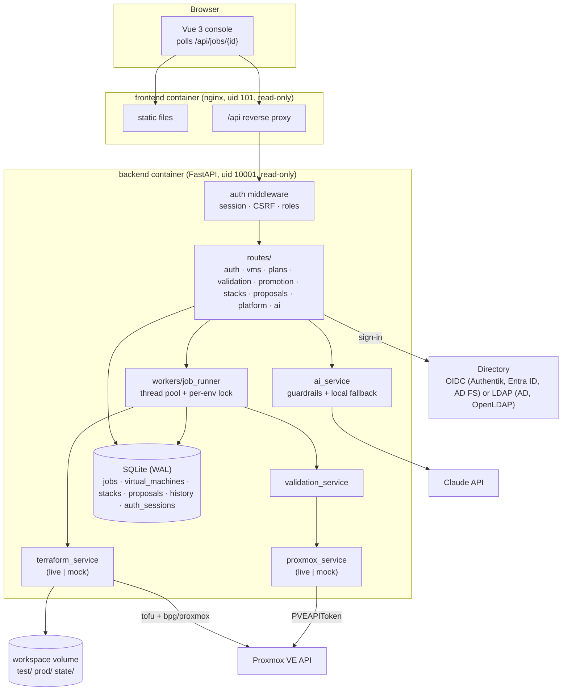
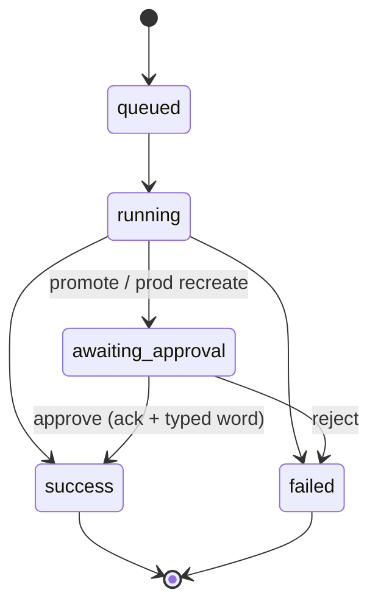
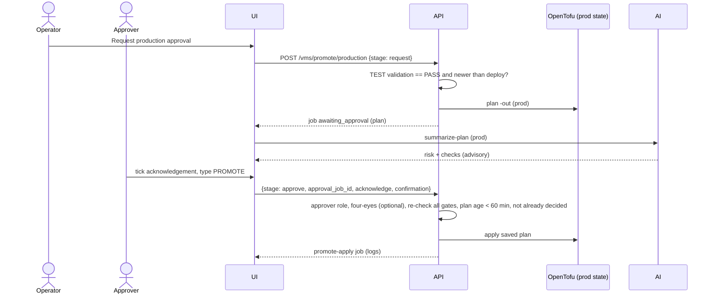

# Architecture

## Components

## Three stacks, three owners

| Stack | Path | Run by | Credentials | Creates |
|---|---|---|---|---|
| Bootstrap | `infra/bootstrap` | an admin, once, `infra/scripts/bootstrap.sh` | admin (shell env only) | role, user, token, ACLs, pool, image/snippet storage, SDN zone + vnets |
| Platform | `infra/platform` | the console (*Platform → Prepare platform*) | least-privilege token | cloud-image downloads, Linux VM templates, LXC templates |
| Machines | `infra` + `environments/*.tfvars` | the console (plan/deploy/promote/recreate, single VMs and stacks) | least-privilege token | VMs (`var.vms`) and LXC containers (`var.containers`); TEST and PROD state separate |

After a VM stack apply, `services/config_service.py` runs Ansible (`infra/ansible/site.yml`) against the new
VM: SSH for Linux, WinRM for Windows, base role plus the VM's profiles.

## Data model

| Table | Purpose |
|---|---|
| `jobs` | Every long-running action: status (`queued`, `running`, `success`, `failed`, `awaiting_approval`), params, logs, result, error, timestamps |
| `virtual_machines` | Desired state per (name, environment): spec, VM ID, IP, last validation. Rendered into OpenTofu `var.vms`. |
| `stacks` | Stacks per environment: spec (components, Docker services), member names, last validation |
| `proposals` | AI drafts waiting for review: software roles and test suites, automated check results, decision and approver |
| `history` | Audit trail: timestamp, resource, environment, action, status, user, plan summary; sign-ins too |
| `auth_sessions` | Signed-in browsers: SHA-256 of the cookie token, user, roles, CSRF token, expiry. Never in backups. |

SQLite is enough for one backend replica (WAL mode + busy timeout). SQLAlchemy keeps the code portable: switching to PostgreSQL is a `DATABASE_URL` change.

## Sign-in and roles

`app/auth` resolves the user for every `/api` request (details and setup: [authentication.md](authentication.md)):

1. **Sign-in.** OIDC: `/api/auth/login` redirects to the provider (PKCE, `state`, `nonce`); `/api/auth/callback` checks
   the ID token against the provider's keys and reads groups from the token or userinfo. LDAP: `POST /api/auth/login`
   looks the user up with the service account and binds as the user over TLS.
2. **Roles** come from the groups (`AUTH_*_GROUPS`): viewer ⊂ operator ⊂ approver. Nobody without a group gets a session.
3. **Session.** A random token goes into an `HttpOnly`, `SameSite=Lax` cookie; the database stores its SHA-256, the
   roles and a CSRF token. Roles change at the next sign-in.
4. **Every request.** No session → 401 (except `/api/health` and `/api/auth/*`). A write needs the operator role and the
   `X-CSRF-Token` header. Approving or rejecting production changes, applying the platform stack and deciding on AI drafts
   call `require_role("approver")`; `AUTH_FOUR_EYES` adds `require_second_person(job.user)`.
5. **Audit.** The route records the signed-in user (`actor()`) in the job before it hands work to the job runner, so
   history and approvals name the person, not a service account.

`AUTH_MODE=none` skips steps 1–4: every request is `APP_USER` with all roles, and the UI shows a warning.

## Backup and restore

`python -m app.cli backup|verify|restore` (wrapped by `scripts/backup.sh` and `scripts/restore.sh`):

| In the archive | Not in the archive |
|---|---|
| SQLite online copy (WAL folded in, `auth_sessions` emptied) | secrets (`secrets/`, `.env`) |
| `workspace/state/` (OpenTofu state: test, prod, platform) | provider caches and plan files (re-created by the next plan) |
| `workspace/profiles/` (approved AI roles), `workspace/known_hosts/` | Ansible run directories |

A restore refuses links, absolute paths and entries outside these folders, checks the database, then replaces the data
and deletes old plan files. Proxmox itself is not touched; the next plan shows any difference.

## Desired state and OpenTofu

- The database is the source of the desired VM list. For each plan the backend writes `/workspace/<env>/generated.tfvars.json` (placement from `.env` + `vms` map) and runs the root module with `-var-file=environments/<env>.tfvars -var-file=generated.tfvars.json`.
- `for_each` over `var.vms` creates one `modules/vm` instance per VM, keyed by name, so adding a VM never touches the others and recreate is `-replace='module.vm["name"].proxmox_virtual_environment_vm.this'`.
- **Separate state**: `tofu init -backend-config=path=/workspace/state/<env>/terraform.tfstate` and a separate `TF_DATA_DIR` per environment. A per-environment lock in the job runner ensures one writer per state.
- **Plan/apply integrity**: plans are saved with `-out`; deploy/approve apply that exact file. If the infrastructure changed in between, OpenTofu refuses (`Saved plan is stale`).
- **Policy in two places**: the API rejects specs over the environment limits; the OpenTofu config repeats the guardrails (`check "resource_limits"`, VM ID range `precondition`), so a manual `tofu apply` with bad input fails too.
- The provider is pre-downloaded into the backend image (`TF_PLUGIN_CACHE_DIR`), and `.terraform.lock.hcl` is committed.

## Job lifecycle

Approval creates a separate `promote-apply` / `recreate-apply` job that applies the parked plan. On backend restart, jobs left in `queued`/`running` are marked failed.

## Promotion sequence

## Mock mode

`LIVE_MODE=false` swaps `ProxmoxClient` for `MockProxmox` and runs the mock OpenTofu planner/applier. Everything else (database, jobs, gates, AI guardrails, UI) is the same code path. The mock:

- lists two templates (IDs from `.env`), storage pools and a VLAN-aware bridge
- renders plan text in OpenTofu format with create / update / destroy / replace
- simulates apply progress, guest-agent IPs from RFC 5737 documentation ranges, cloud-init completion
- can fail validation on demand (UI checkbox or `MOCK_FAIL_VALIDATION=true`)
- rehydrates simulated VMs from the database after a restart
