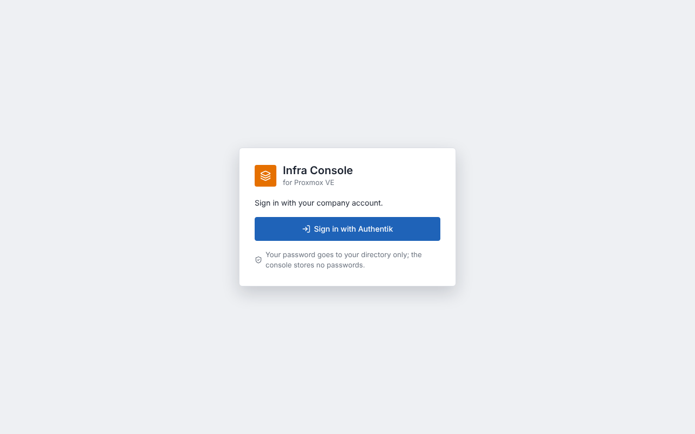
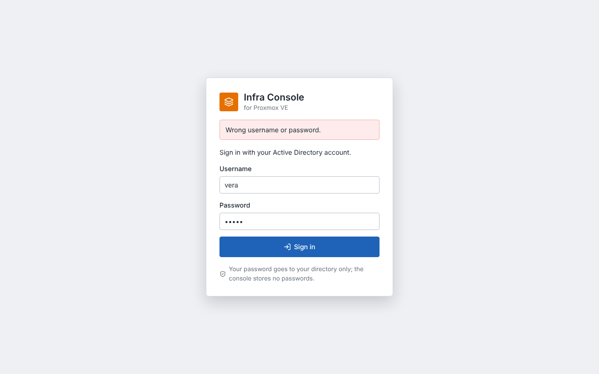

# Sign-in and roles

The console signs people in against your existing directory. It stores no passwords and has no user database
of its own: who someone is and which role they get comes from their groups.

| `AUTH_MODE` | For | How |
|---|---|---|
| `oidc` | **Authentik**, **Microsoft Entra ID**, **AD FS**, Keycloak, any OpenID Connect provider | Single sign-on: authorization code flow with PKCE |
| `ldap` | **Active Directory**, **OpenLDAP**, Authentik LDAP outpost | Username and password, checked by binding to the directory over TLS |
| `none` | A demo on your own machine | No sign-in. Everyone who reaches the page is `APP_USER` with every role. The UI shows a warning. |



## Roles

| Role | May |
|---|---|
| **viewer** | See everything: machines, stacks, plans, logs, history |
| **operator** | Plan, deploy, validate and configure in Test; request production changes; draft software and tests with the assistant |
| **approver** | Approve or reject production changes, apply the platform stack, approve AI drafts |

An approver is also an operator, and an operator is also a viewer. Someone in none of the groups cannot sign in.

```dotenv
AUTH_VIEWER_GROUPS=px-viewers
AUTH_OPERATOR_GROUPS=px-operators
AUTH_APPROVER_GROUPS=px-approvers
AUTH_FOUR_EYES=true
```

- Separate several groups with `;` (DNs contain commas).
- A group matches by its full value (a DN, a name or an Entra object ID) or by its first `CN=`, so
  `px-operators` matches `CN=px-operators,OU=Groups,DC=corp,DC=example`. Case does not matter.
- `AUTH_FOUR_EYES=true`: the person who requested a production change cannot approve or reject it.
- Roles are read at sign-in. After changing someone's groups, they sign out and in again. Sessions last
  `AUTH_SESSION_HOURS` (default 8).
- The server enforces all of this. The UI only hides buttons a role cannot use.

## Before you start: HTTPS

Put the console behind a reverse proxy that terminates HTTPS (your existing nginx, Traefik, Caddy, …) and set:

```dotenv
PUBLIC_URL=https://console.example.internal   # what people type in the browser
AUTH_COOKIE_SECURE=true                       # session cookie only over HTTPS
FRONTEND_BIND=127.0.0.1                       # the proxy on this host reaches the console, nobody else
```

The session cookie is `HttpOnly`, `SameSite=Lax` and, with `AUTH_COOKIE_SECURE=true`, sent only over HTTPS.
`AUTH_COOKIE_SECURE=false` exists for a plain-HTTP lab; do not use it on a network others share.

Secrets go into files, not into `.env`:

```bash
printf '%s' '<client secret>'       > secrets/oidc_client_secret     # OIDC
printf '%s' '<bind password>'       > secrets/ldap_bind_password     # LDAP
chmod 600 secrets/* && sudo chown 10001:10001 secrets/*
docker compose -f docker-compose.yml -f docker-compose.secrets.yml up -d
```

## Authentik (OIDC)

1. **Applications → Providers → Create → OAuth2/OpenID Provider**
   - Name `proxmox-console`, authorization flow *default-provider-authorization-implicit-consent*
   - Client type **Confidential**; copy the *Client ID* and *Client Secret*
   - Redirect URI (strict): `https://console.example.internal/api/auth/callback`
   - Signing key: *authentik Self-signed Certificate* (or your own). Scopes: the default `openid`, `email`, `profile`
2. **Applications → Applications → Create**: name *Proxmox Console*, slug `proxmox-console`, provider from step 1.
3. **Directory → Groups**: create `px-viewers`, `px-operators`, `px-approvers` and add people.
4. `.env`:
   ```dotenv
   AUTH_MODE=oidc
   AUTH_PROVIDER_NAME=Authentik
   OIDC_ISSUER=https://authentik.example.internal/application/o/proxmox-console/
   OIDC_CLIENT_ID=<client id>
   ```
   and the secret in `secrets/oidc_client_secret`. The issuer is shown on the provider page (*OpenID Configuration Issuer*);
   copy it exactly, including the trailing `/`.

Authentik sends group names in the `groups` claim (scope `profile`). The console also reads them from the userinfo
endpoint, so *Include claims in id_token* may stay off.

## Microsoft Entra ID (OIDC)

1. **Entra admin center → App registrations → New registration**: name *Proxmox Console*, single tenant,
   redirect URI type **Web**: `https://console.example.internal/api/auth/callback`.
2. **Certificates & secrets → New client secret**: copy the value into `secrets/oidc_client_secret`.
3. Choose how roles reach the console:
   - **Groups** (simple): *Token configuration → Add groups claim → Security groups*. Entra sends group **object IDs**,
     so put those IDs into `AUTH_*_GROUPS`. With more than 200 groups per user Entra omits the claim; then use app roles.
   - **App roles** (recommended for large tenants): *App roles → Create* `viewer`, `operator`, `approver`, assign
     users or groups under *Enterprise applications → Users and groups*, and set `OIDC_GROUPS_CLAIM=roles` with
     `AUTH_OPERATOR_GROUPS=operator` and so on.
4. `.env`:
   ```dotenv
   AUTH_MODE=oidc
   AUTH_PROVIDER_NAME=Microsoft
   OIDC_ISSUER=https://login.microsoftonline.com/<tenant-id>/v2.0
   OIDC_CLIENT_ID=<application (client) id>
   OIDC_USERNAME_CLAIM=preferred_username
   ```

## AD FS (OIDC)

1. **AD FS Management → Application Groups → Add**: *Server application accessing a web API* (or *Web browser accessing a
   web application* with a client secret). Redirect URI `https://console.example.internal/api/auth/callback`;
   generate a shared secret for `secrets/oidc_client_secret`.
2. In the web API part, add the issuance transform rule *Send LDAP Attributes as Claims*: attribute store *Active
   Directory*, `Token-Groups - Unqualified Names` → outgoing claim type `groups`, and `User-Principal-Name` → `upn`.
3. Permit the scopes `openid`, `profile`, `email` and `allatclaims`.
4. `.env`:
   ```dotenv
   AUTH_MODE=oidc
   AUTH_PROVIDER_NAME=Company account
   OIDC_ISSUER=https://adfs.example.internal/adfs
   OIDC_CLIENT_ID=<client identifier>
   OIDC_SCOPES=openid profile email allatclaims
   OIDC_USERNAME_CLAIM=upn
   ```

## Active Directory (LDAP)



1. Create a service account for lookups, e.g. `svc-proxmox-console`: a normal domain user with a long password and no
   other rights (every domain user may read users and groups). Its password goes into `secrets/ldap_bind_password`.
2. Create groups `PX-Viewers`, `PX-Operators`, `PX-Approvers` (nested groups work, see below).
3. The domain controllers need an LDAPS certificate (AD CS *Domain Controller* / *Kerberos Authentication* template, or
   your PKI). Copy the issuing CA certificate (PEM) to `certs/ldap-ca.crt` next to `docker-compose.yml`.
4. `.env`:
   ```dotenv
   AUTH_MODE=ldap
   AUTH_PROVIDER_NAME=Active Directory
   LDAP_URL=ldaps://dc01.corp.example.internal:636
   LDAP_CA_FILE=/certs/ldap-ca.crt
   LDAP_BIND_DN=CN=svc-proxmox-console,OU=Service Accounts,DC=corp,DC=example,DC=internal
   LDAP_BASE_DN=DC=corp,DC=example,DC=internal
   LDAP_USER_FILTER=(&(objectClass=user)(|(sAMAccountName={username})(userPrincipalName={username})))
   LDAP_USERNAME_ATTRIBUTE=sAMAccountName
   LDAP_NESTED_GROUPS=true
   AUTH_VIEWER_GROUPS=PX-Viewers
   AUTH_OPERATOR_GROUPS=PX-Operators
   AUTH_APPROVER_GROUPS=PX-Approvers
   ```

- People sign in with their short name (`anna`) or UPN (`anna@corp.example.internal`). The history always records the
  `sAMAccountName`, so both are the same person for the four-eyes rule.
- `LDAP_NESTED_GROUPS=true` resolves groups inside groups (`LDAP_MATCHING_RULE_IN_CHAIN`): someone in *Infra-Leads*,
  which is a member of *PX-Approvers*, is an approver.
- To exclude disabled accounts at lookup time, add `(!(userAccountControl:1.2.840.113556.1.4.803:=2))` to the filter.
  AD refuses the password bind for disabled accounts anyway.
- No StartTLS-capable DC? Keep LDAPS. Plain `ldap://` without `LDAP_START_TLS=true` is refused, because the password
  would cross the network unencrypted.

## OpenLDAP (LDAP)

Requires the `memberof` overlay (groups of type `groupOfNames` or `groupOfUniqueNames`).

```dotenv
AUTH_MODE=ldap
AUTH_PROVIDER_NAME=Directory
LDAP_URL=ldaps://ldap.example.internal:636        # or ldap://...:389 with LDAP_START_TLS=true
LDAP_CA_FILE=/certs/ldap-ca.crt
LDAP_BIND_DN=uid=svc-console,ou=people,dc=example,dc=internal
LDAP_BASE_DN=dc=example,dc=internal
LDAP_USER_FILTER=(&(objectClass=inetOrgPerson)(uid={username}))
LDAP_USERNAME_ATTRIBUTE=uid
LDAP_NESTED_GROUPS=false
AUTH_VIEWER_GROUPS=px-viewers
AUTH_OPERATOR_GROUPS=px-operators
AUTH_APPROVER_GROUPS=px-approvers
```

The service account needs read access to the people and group entries (`olcAccess: ... by dn="uid=svc-console,..." read`);
without it the directory answers *no such object*.

## Authentik LDAP outpost (LDAP)

If you prefer a password form over the Authentik login page: create an LDAP provider and outpost in Authentik, a service
account with the *Search full LDAP directory* permission, then

```dotenv
AUTH_MODE=ldap
LDAP_URL=ldaps://authentik-ldap.example.internal:636
LDAP_BIND_DN=cn=svc-console,ou=users,dc=ldap,dc=goauthentik,dc=io
LDAP_BASE_DN=dc=ldap,dc=goauthentik,dc=io
LDAP_USER_FILTER=(cn={username})
LDAP_USERNAME_ATTRIBUTE=cn
LDAP_NESTED_GROUPS=false
```

OIDC is the better fit for Authentik: people get single sign-on and its MFA.

## Security notes

- **No password reaches the console's disk or logs.** OIDC: the provider sees the password. LDAP: the backend passes it
  to the directory once over TLS and forgets it. Empty passwords are refused (they would be anonymous binds).
- **Sessions** are random 256-bit tokens in an `HttpOnly` cookie; the database stores only their SHA-256. Signing out
  deletes the session. Every change needs the session's CSRF token (`X-CSRF-Token`), and LDAP sign-in from another
  site's page is refused (Origin check).
- **OIDC**: PKCE (S256), `state` and `nonce` are single use for 10 minutes; the ID token's signature, issuer, audience
  and expiry are checked against the provider's published keys.
- **LDAP**: user input is escaped in the filter; five wrong passwords lock a username for five minutes (per console
  process). Your directory's own lockout policy still applies.
- **Audit**: sign-ins and every job, approval and rejection record the signed-in user in the history.
- `/api/health` answers anonymous callers with `{"status": "ok"}` only (for the container health check).

## Troubleshooting

| Symptom | Cause | Fix |
|---|---|---|
| *You signed in, but you are in none of the console's groups* | Group names do not match | Compare with what the provider sends: Entra = object IDs, AD = `CN=…`, Authentik = names. Separate with `;` |
| *The provider reports issuer …, expected …* | `OIDC_ISSUER` differs from the provider's issuer | Copy the issuer exactly (trailing `/` for Authentik) |
| *The provider refused the code* | Wrong client secret or redirect URI | Redirect URI must be exactly `PUBLIC_URL/api/auth/callback` |
| *The sign-in attempt expired or was started elsewhere* | More than 10 minutes on the provider page, or the backend restarted | Sign in again |
| *Cannot reach or bind to the directory* | DNS/firewall, wrong bind DN/password, untrusted certificate | `openssl s_client -connect dc01:636 -CAfile certs/ldap-ca.crt`; check `LDAP_BIND_DN` |
| *Directory search failed: LDAPNoSuchObjectResult* | `LDAP_BASE_DN` wrong or the service account may not read it | Check the base DN and the account's read rights |
| Sign-in works but you are back on the sign-in page | Cookie not stored: `AUTH_COOKIE_SECURE=true` over plain HTTP | Use HTTPS (or `false` in a lab) |
| *Missing or wrong CSRF token* | Session ended in another tab | Reload the page |

## What was tested

On 2026-10-19 the console (backend image, real browser) was run against:

- **OpenLDAP 2.4** (osixia/openldap, `memberof` overlay) over LDAPS and over StartTLS: viewer, operator and approver
  roles, wrong password, filter injection, a user without a console group, CSRF, role checks, sign-out; plain `ldap://`
  refused.
- **Samba 4.17 Active Directory** (`samba-tool domain provision`): the same checks, plus a nested group
  (user → *Infra-Leads* → *PX-Approvers*), a group name with a space, and sign-in by UPN recorded as `sAMAccountName`.
- **Authentik 2025.10** (OIDC, groups via userinfo): browser sign-in for each role and for a user without a group.

Microsoft Entra ID and AD FS were not available for testing; both are standard OpenID Connect providers and use the
same code path as Authentik. The settings above follow their documentation.
