# Screenshots

Captured from mock mode (`LIVE_MODE=false`) with a headless browser walking through the full workflow. All IPs are RFC 5737 documentation addresses.

| | |
|---|---|
| 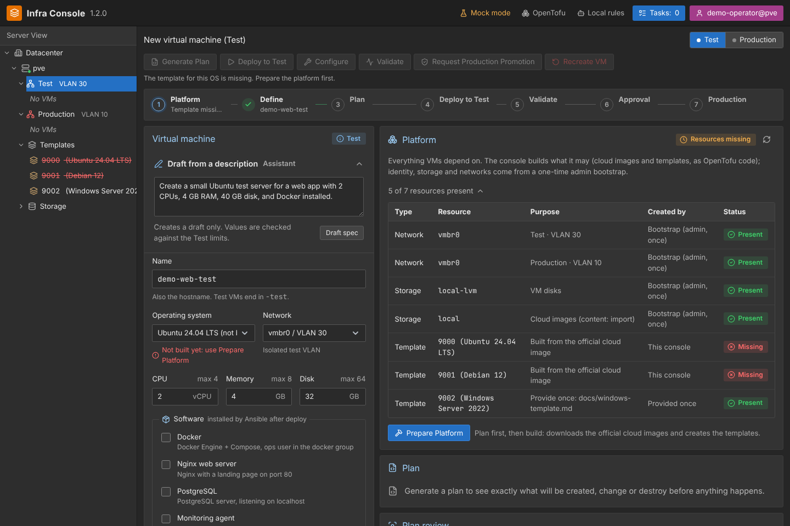 **0. Platform** – the console notices missing templates | 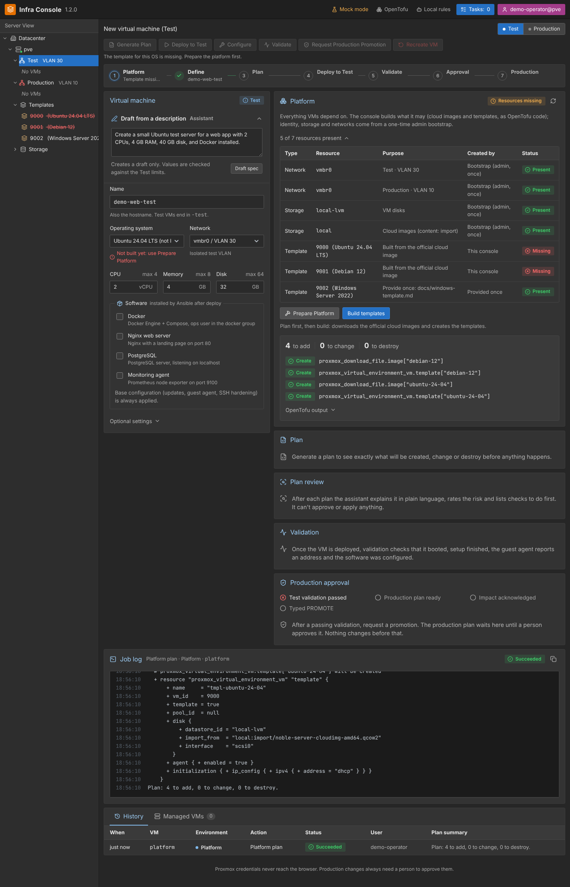 **0b. Prepare Platform** – cloud images + templates as a plan |
| 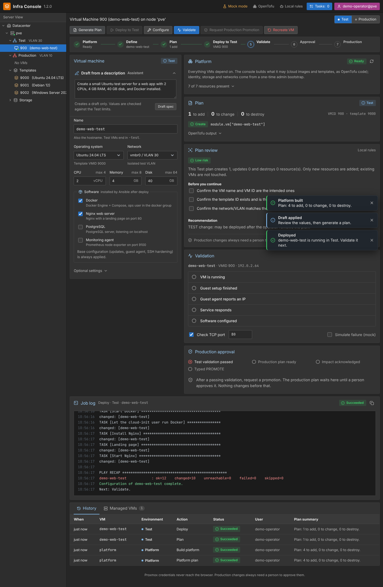 **3b. Deploy + Ansible** – software installed after deploy | 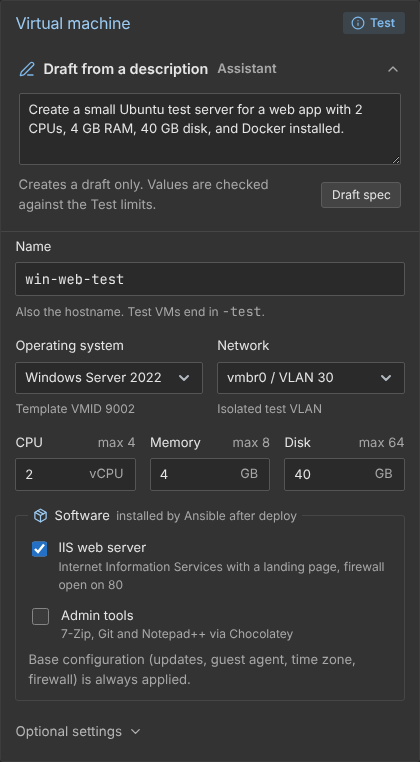 **9. Windows** – IIS and admin tools profiles |
| 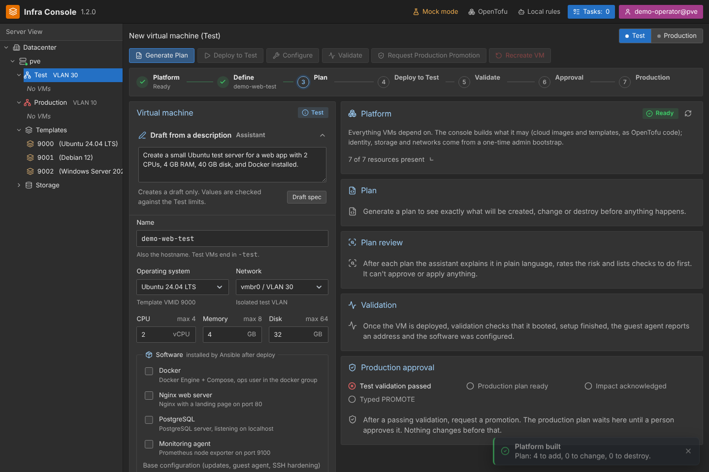 **1. Console** – Proxmox-style resource tree, toolbar, progress bar, VM form | 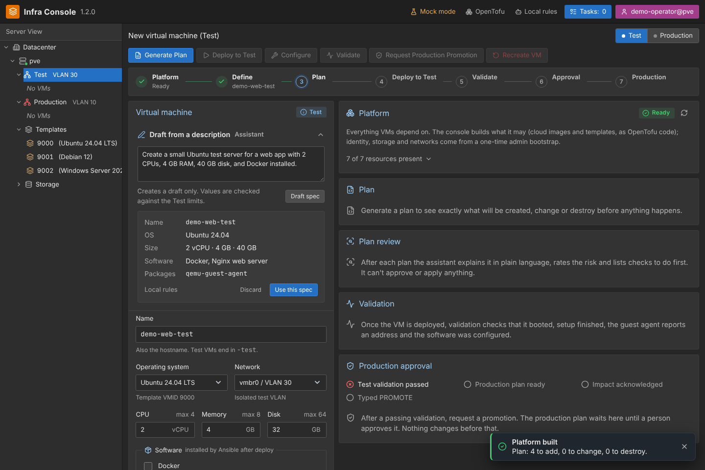 **2. Draft from a description** – natural language to a validated draft |
| 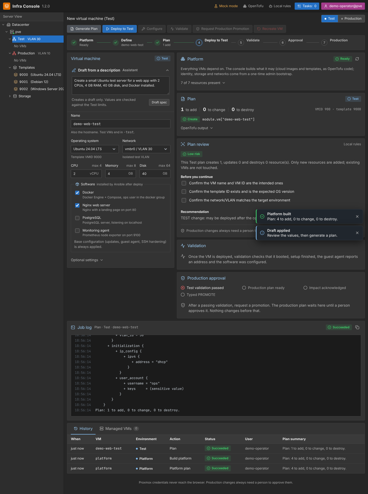 **3. Plan + review** – counts, changes, low risk, pre-flight checklist | 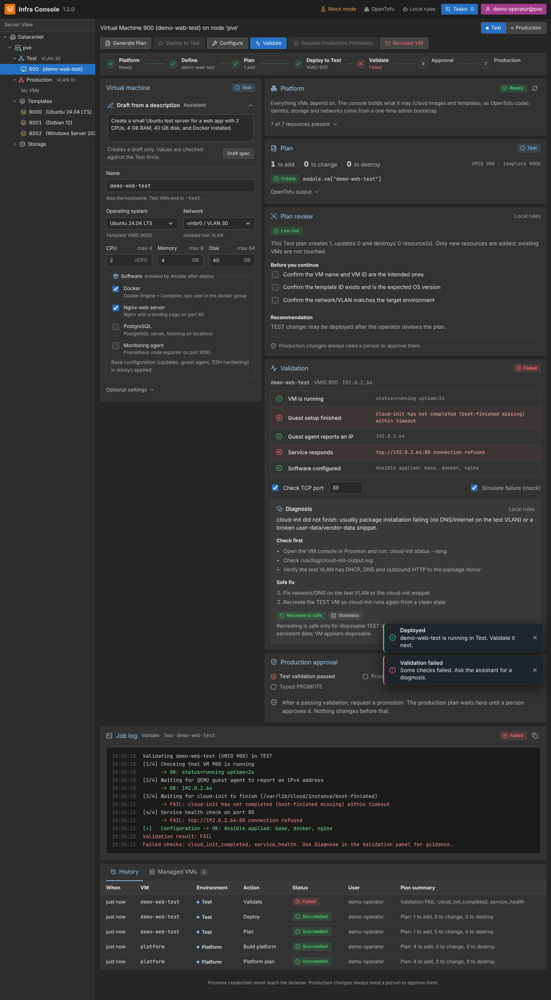 **4. Failed validation** – diagnosis suggests a recreate |
| 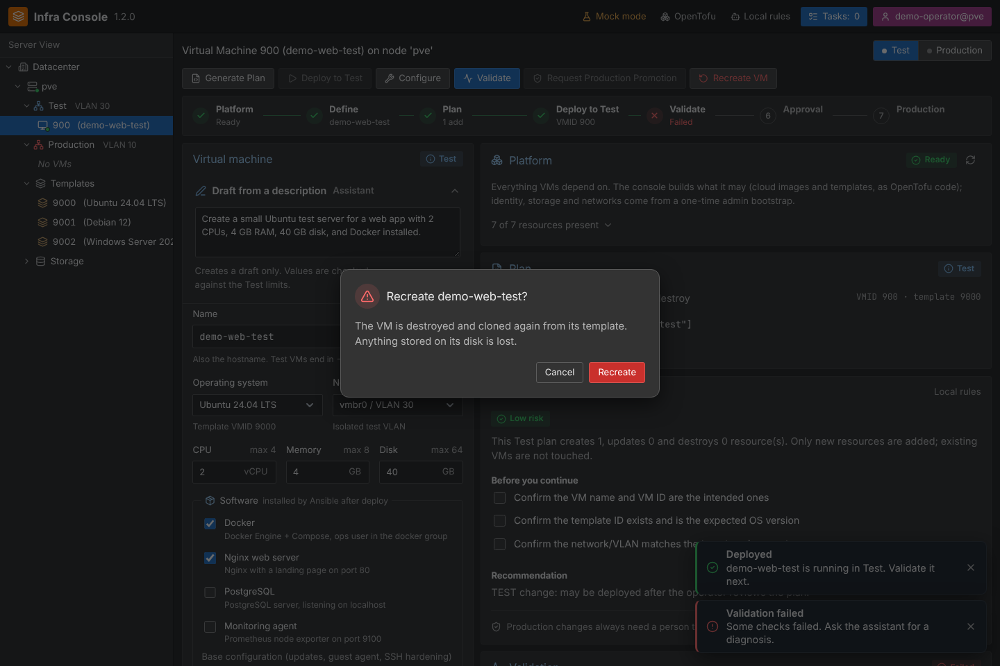 **4b. Confirmation** – destructive actions ask first | |
| 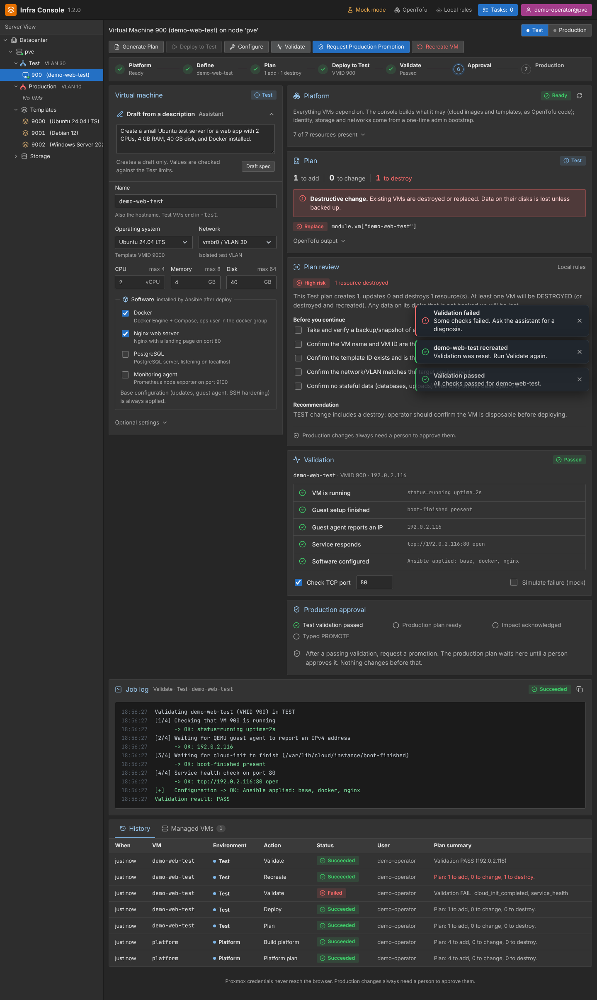 **5. Validation passed** – running, cloud-init, guest-agent IP, port 22 | 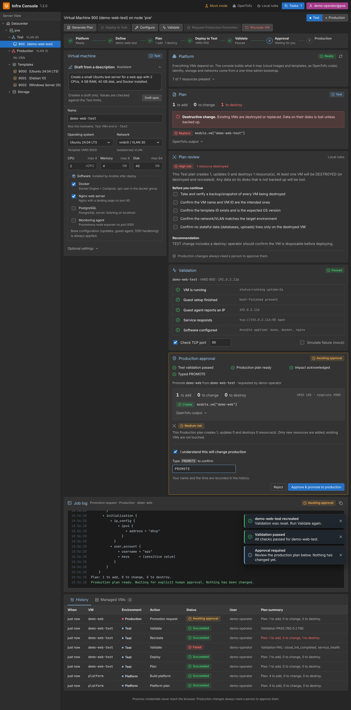 **6. Production approval** – gates, plan, risk, acknowledgement + typed PROMOTE |
| 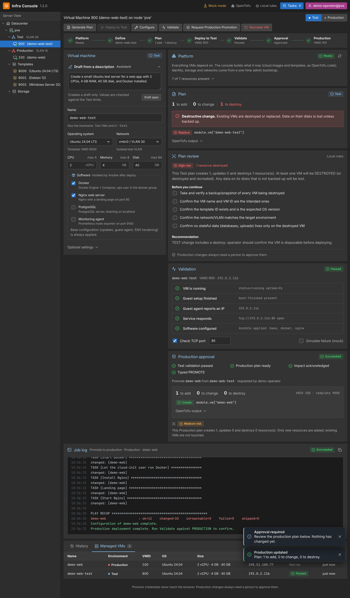 **7. History / managed VMs** | 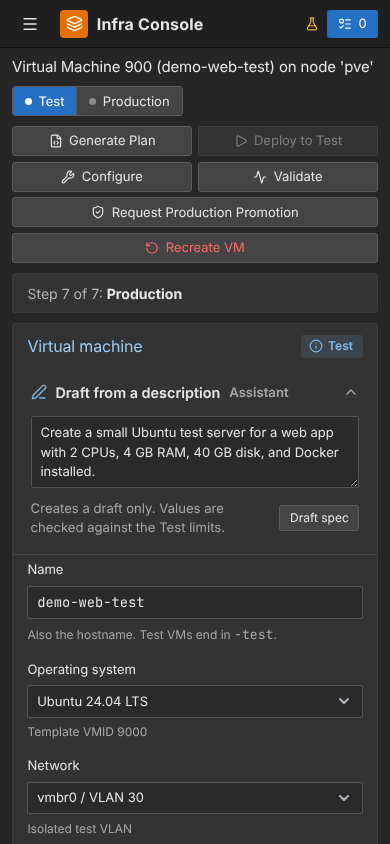 **8. Mobile layout** |

To regenerate: start the stack in mock mode, reset data (`docker compose down -v && docker compose up -d`) and capture the same steps as in [DEMO.md](../DEMO.md).
