# Screenshots

Captured in mock mode (`LIVE_MODE=false`) by a headless browser walking through [DEMO.md](../DEMO.md). All IPs are RFC 5737 documentation addresses.

| | |
|---|---|
|  **Dashboard** – status cards, recent activity, one primary action | 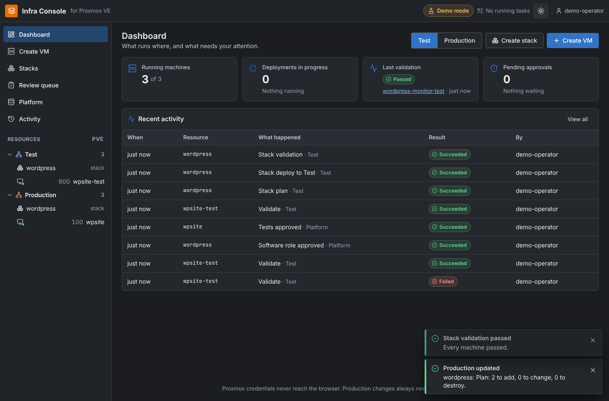 **Dark theme** – same layout, tonal surfaces |
| 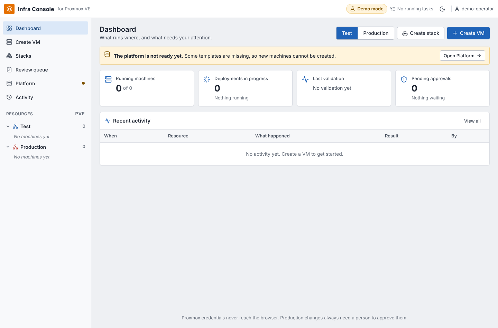 **First start** – platform banner, empty states | 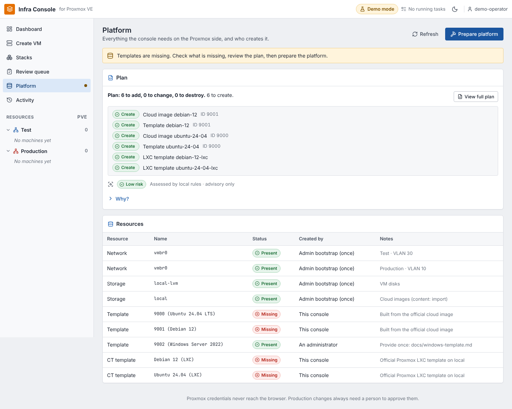 **Platform** – what the console needs, who creates it, plan before building |
| 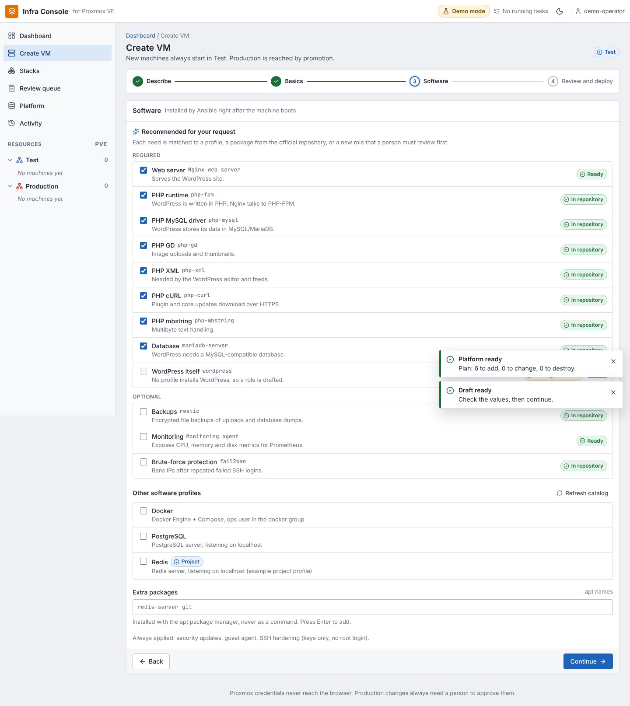 **Create VM · Software** – required/optional needs, repository-checked packages, role draft waiting for review | 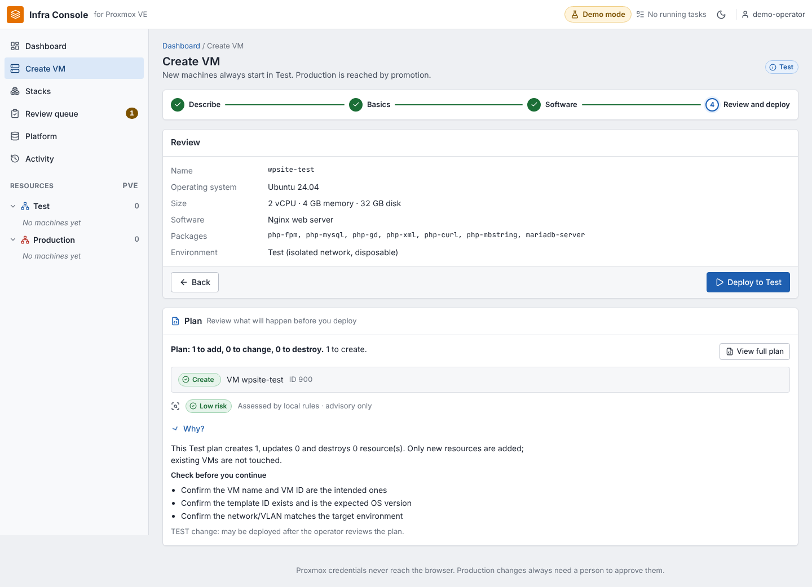 **Create VM · Review and deploy** – plan as a sentence, risk badge, *Why?* |
| 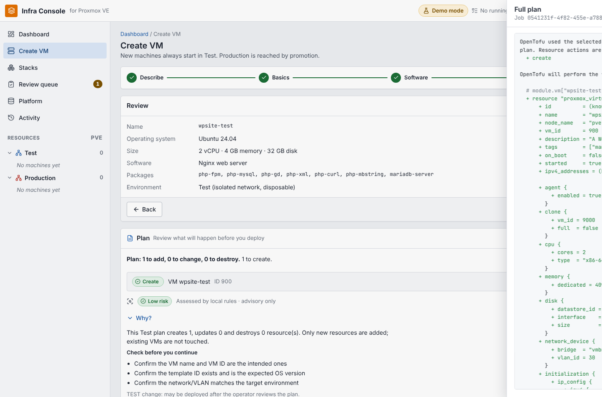 **Side panel** – full OpenTofu plan, highlighted and copyable | 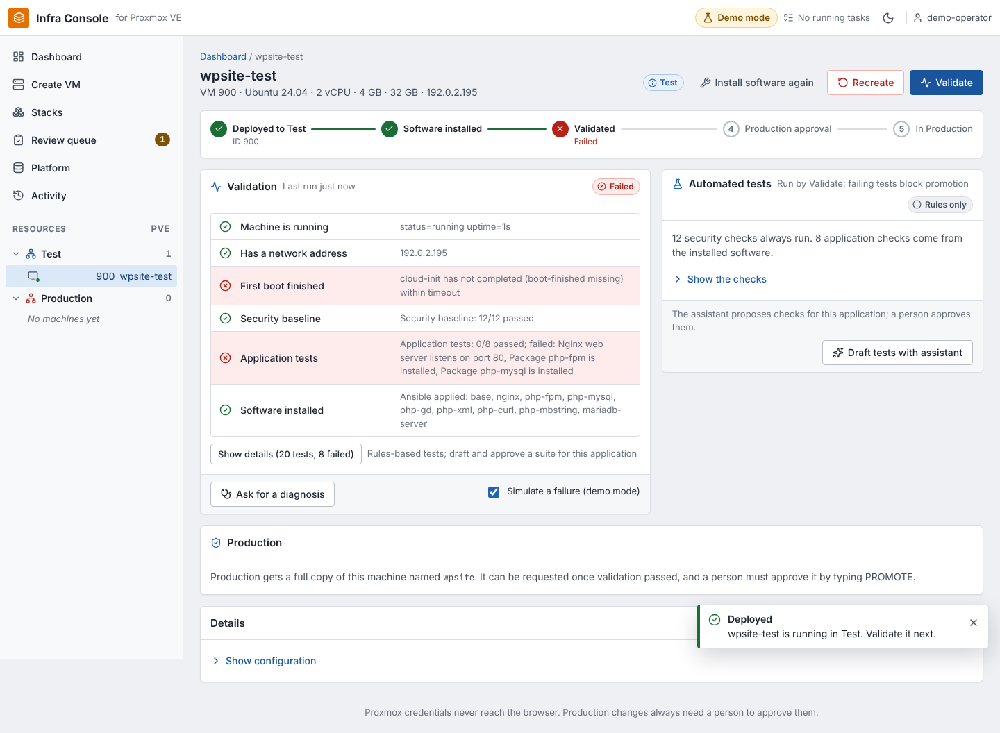 **Validation failed** – compact checklist, lifecycle step in red |
| 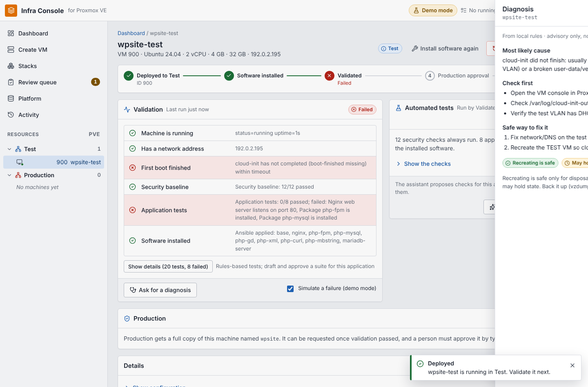 **Diagnosis** – advisory, in a side panel | 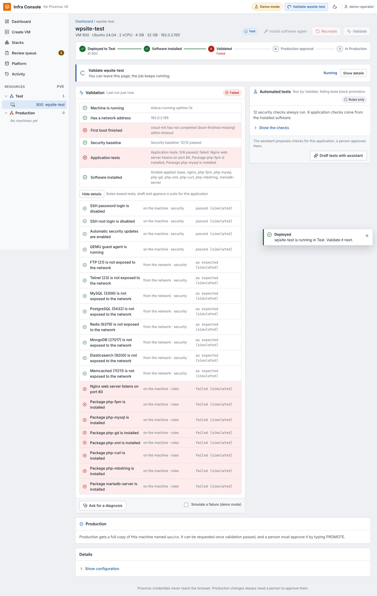 **Validation passed** – security baseline and application tests |
|  **Review queue** – production requests and AI drafts | 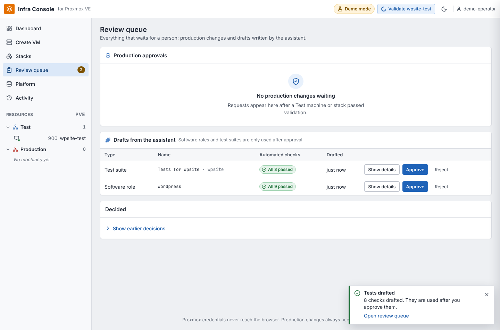 **Draft details** – automated safety checks, then the artefact |
| 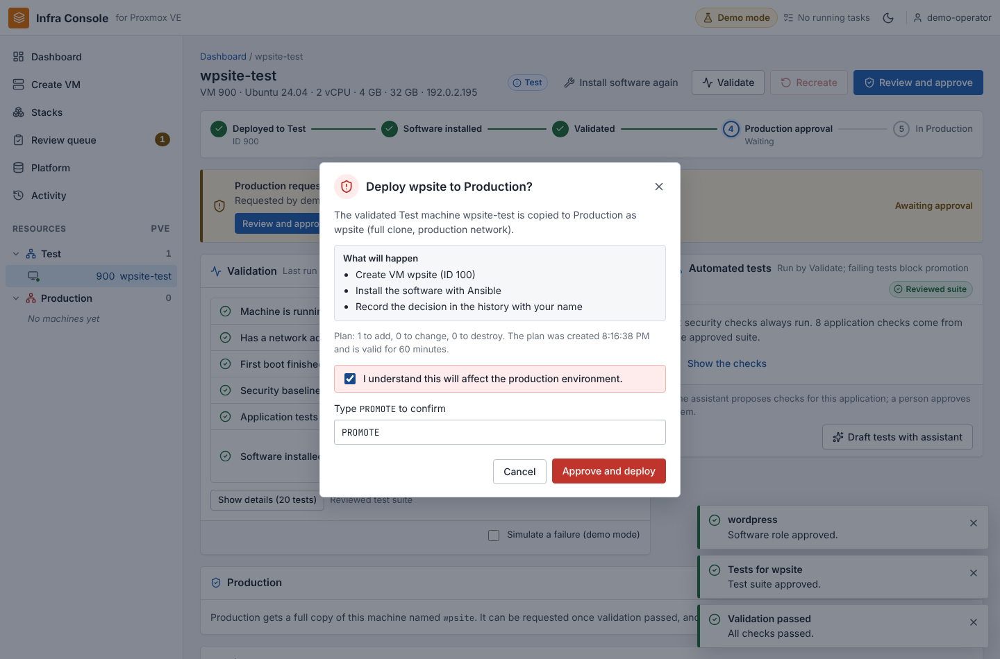 **Production approval** – what will happen, acknowledgement, typed `PROMOTE` | 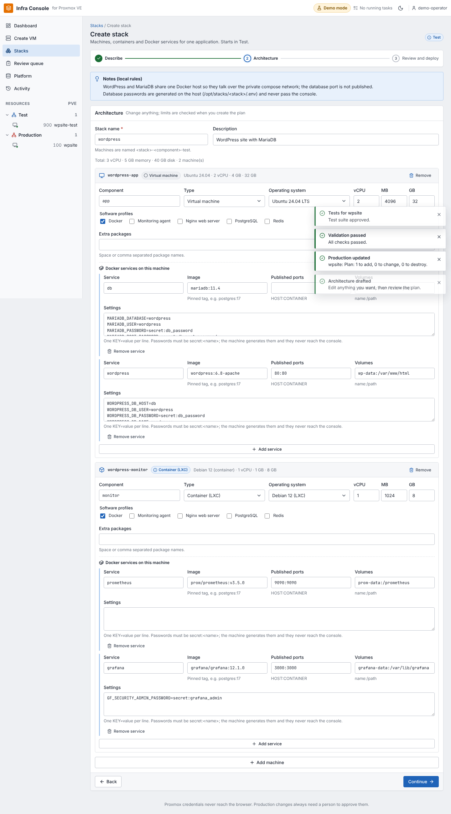 **Stack architecture** – VM + LXC, Docker services, `secret:` references |
| 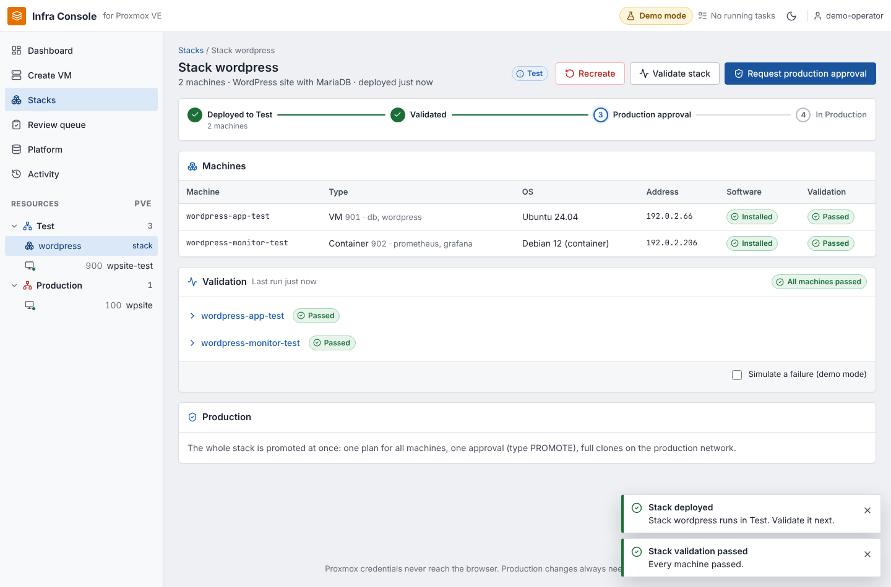 **Stack page** – members, per-machine validation | 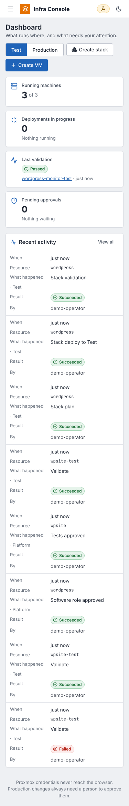 **375 px** – navigation as a slide-in panel, tables as cards |
